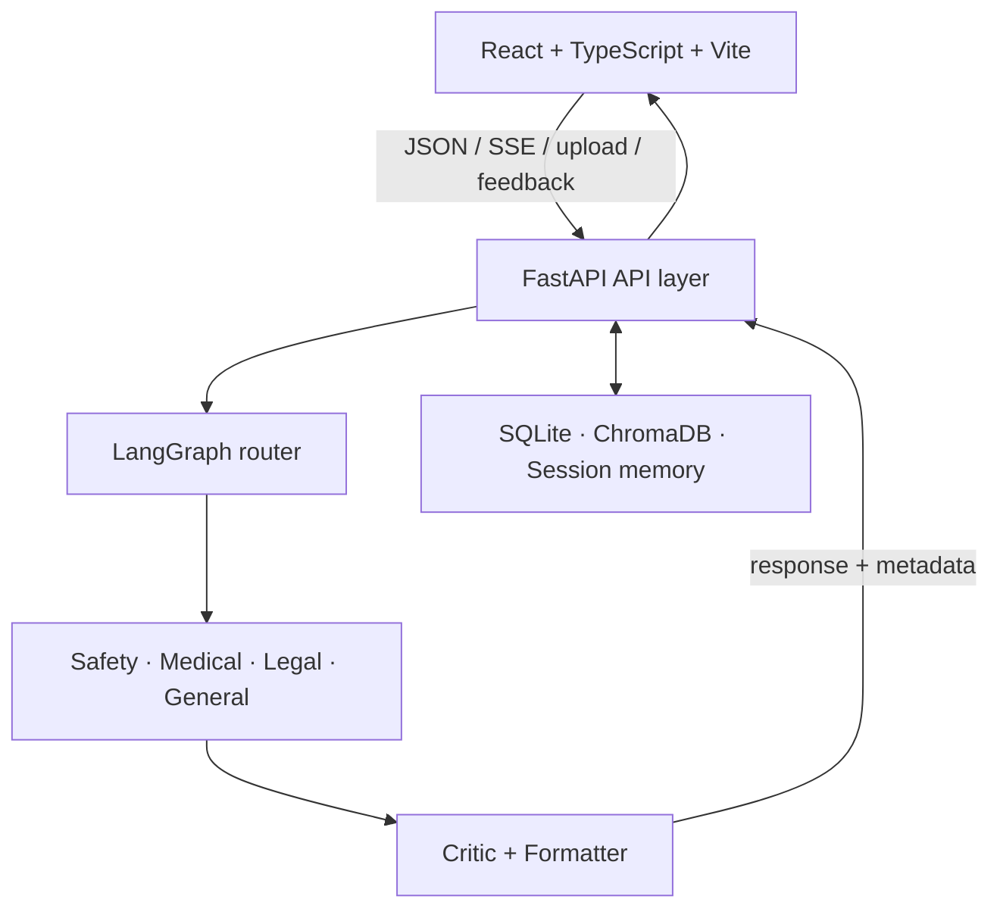
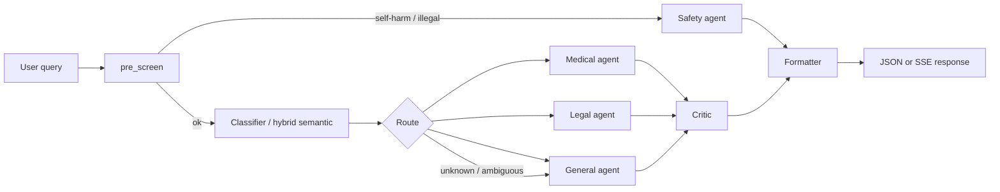
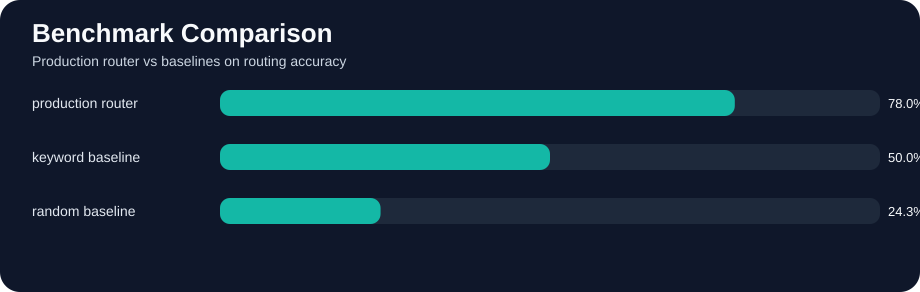
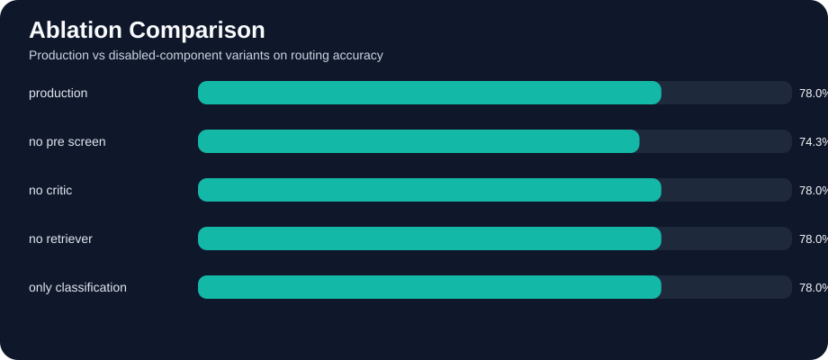
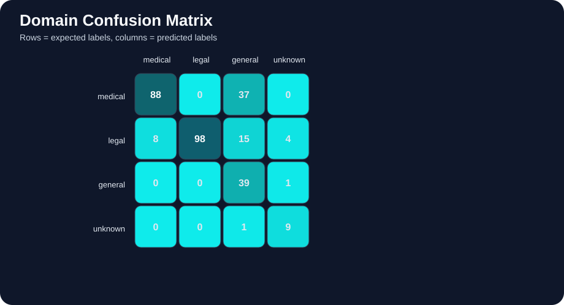
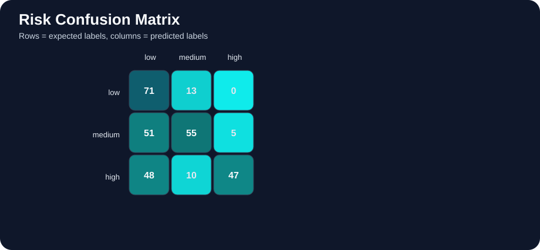
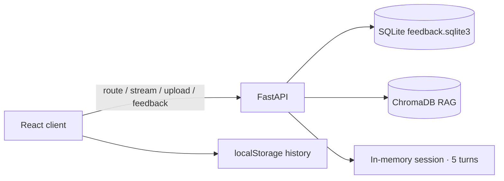

# SochSamajh AI — Responsible Multi-Agent Query Routing System

> Safety-first FastAPI + LangGraph router that classifies medical/legal/general queries by domain and risk, with RAG grounding, explainable routing, and a 300-case evaluation suite.

[](LICENSE)
[](https://github.com/Sanjeev2004/SochSamajh-AI-Responsible-Multi-Agent-Query-Routing-System/actions/workflows/ci.yml)
[](https://github.com/Sanjeev2004/SochSamajh-AI-Responsible-Multi-Agent-Query-Routing-System/actions/workflows/eval.yml)


**Live demo:** [https://soch-samajh-ai-responsible-multi-ag.vercel.app/](https://soch-samajh-ai-responsible-multi-ag.vercel.app/)

A deployable, measurable responsible-AI system for medical and legal query routing — not only a chatbot UI. Built as a B.Tech major-project style stack with safety gates, multi-agent orchestration, structured evaluation, and full-stack CI/CD.

---

## Project strengths

- **Safety pipeline first** — pre-screen for self-harm and illegal intent before any domain agent runs
- **Measurable evaluation** — 300-case dataset with keyword/random baselines, ablations, and offline metrics (routing ~83%, risk ~76%)
- **Explainability UI** — “Why this route?”, confidence, triggered terms, and pipeline-trace step chips
- **CI/CD** — GitHub Actions for pytest + frontend build (`ci.yml`) and router regression (`eval.yml`)
- **Full-stack deploy** — FastAPI on Render, React/Vite on Vercel, Docker Compose for VPS
- **India / Hinglish coverage** — domain anchors and demo prompts for FIR, dog-bite urgency, and mixed Hindi–English queries
- **Critic-enforced disclaimers** — medical/legal answers must carry educational / jurisdiction warnings
- **117+ automated tests** across classifier, risk scoring, API, feedback, retriever, and router flows

---

## Architecture

### System overview



### Routing pipeline



**Lifecycle (short):** rate limit → pre-screen → classify domain + risk → specialised agent → critic disclaimer check → formatter → JSON or SSE. Optional `user_context` from PDF/TXT upload; optional `session_id` for the last five turns.

| Path | Responsibility |
|---|---|
| `backend/api/` | `/api/route`, `/api/route/stream`, `/api/upload`, `/api/health`, `/api/feedback`, `/api/session/{id}` |
| `backend/agents/` | Classifier, semantic router, Safety, Medical, Legal, General, Critic, Formatter, Retriever |
| `backend/core/` | Settings, LangGraph construction, structured state |
| `backend/services/` | Streaming, document parse, session memory, retriever gating |
| `backend/evaluation/` | Dataset, baselines, ablations, judge, visualizations |
| `backend/tests/` | 14 modules, **117+** tests |

---

## Comparison

Generic chatbots are broad. SochSamajh AI is **controlled, auditable, and measurable** for medical/legal routing. This is not a claim of being universally smarter than ChatGPT or Gemini — it is a claim of stronger **ownership and safety structure** for this problem.

| Area | SochSamajh AI | ChatGPT / Gemini | Naive single-prompt bot |
|---|---|---|---|
| Routing | Explicit medical / legal / general / safety agents | One general assistant flow | Single prompt, no domain agents |
| Safety | Dedicated pre-screen + safety route before answers | Prompt / policy dependent | Usually none beyond the prompt |
| Risk metadata | Returns `risk_level`, `safety_flags`, pipeline trace | Usually hidden from the app | Not structured |
| Disclaimers | Critic + formatter enforced | May vary answer to answer | Easy to omit |
| Ambiguity | Can route `unknown` and ask to clarify | Often answers early | Often answers early |
| Evaluation | 300-case dataset, baselines, ablations, CI | Informal / external | Rarely measured |
| Ownership | Your deployable, inspectable system | External product | Script or notebook only |

---

## Evaluation and graphs

Primary offline numbers on the **300-case** dataset (honest snapshot used for viva / review):

| Metric | Score |
|---|---|
| Routing accuracy | **~83%** |
| Routing macro F1 | **~79.7%** |
| Risk accuracy | **~76%** after Nov 2026 overhaul (was ~**62%**) |
| Dataset | 300 cases; keyword + random baselines; ablations (e.g. pre-screen impact) |
| Tests | **117+** pytest cases in CI |

Older SVG / HTML snapshots in the repo may still show previous percentages. **Use the table above as the primary numbers**; the charts remain useful for benchmark vs baseline structure and confusion patterns.

### Benchmark vs baselines



### Ablation comparison



### Domain confusion matrix



### Risk confusion matrix



Full interactive visual report: [`backend/evaluation/visualizations/index.html`](backend/evaluation/visualizations/index.html)

```bash
cd backend
python evaluation/judge.py
# python evaluation/judge.py --judge-sample-size 10
# python evaluation/judge.py --disable-llm-judge
```

Writes `backend/evaluation/report.json` from [`backend/evaluation/dataset.json`](backend/evaluation/dataset.json).

---

## Databases and storage

| Store | Tech | Role | Persistence |
|---|---|---|---|
| Feedback DB | **SQLite** `feedback.sqlite3` via **aiosqlite** | Thumbs up/down ratings, summary, failure-analysis candidates | Docker volume / **Render disk** at `/app/data` |
| Vector store | **ChromaDB** under `backend/rag/chroma_db/` | RAG grounding for medical/legal corpora | Rebuild with `python -m rag.ingest`; keyword fallback if embeddings/Chroma fail |
| Session memory | In-process dict (last **5** turns per `session_id`) | Multi-turn context for `/api/route` | Cleared with `DELETE /api/session/{id}` (not durable across restarts) |
| Chat history UI | Frontend **localStorage** (`sochsamajh_history`) | Sidebar of recent queries (up to 20) | Browser-local only |



After editing files under `backend/rag/data/`:

```bash
cd backend
python -m rag.ingest
```

Set `ENABLE_RETRIEVER=true` for the API to use retrieval. If sentence-transformers or Chroma cannot load, the retriever falls back to an in-process keyword scorer over the same `.txt` files so the pipeline does not crash.

---

## Quick start

**Prerequisites:** Python 3.11+, Node.js 18+ (Docker optional)

### Backend

```bash
cd backend
python -m venv venv
source venv/bin/activate   # Windows: .\venv\Scripts\Activate.ps1
pip install -r requirements.txt
cp .env.example .env
uvicorn api.main:app --port 8000 --reload
```

Environment (from [`backend/.env.example`](backend/.env.example); **Groq recommended**):

| Variable | Description | Default / notes |
|---|---|---|
| `LLM_PROVIDER` | `groq` (recommended) or `openai` | `groq` in `.env.example` |
| `GROQ_API_KEY` | Groq API key | required when using Groq |
| `GROQ_MODEL` | Groq model | `llama-3.3-70b-versatile` |
| `OPENAI_API_KEY` | OpenAI key (if using OpenAI) | — |
| `ENABLE_LLM` | Live LLM calls (`true` spends credits) | `false` |
| `ENABLE_RETRIEVER` | Chroma / keyword RAG | `false` |
| `ENABLE_SEMANTIC_ROUTER` | Hybrid semantic cascade | `false` |
| `BACKEND_CORS_ORIGINS` | Allowed origins (comma-separated) | `http://localhost:5173` |
| `LANGSMITH_API_KEY` / `LANGCHAIN_TRACING_V2` | Optional tracing | off by default |

### Frontend

```bash
cd frontend
npm install
npm run dev
```

Visit <http://localhost:5173>.

### Deploy (short)

- **Backend:** Render via [`render.yaml`](render.yaml); mount a disk at `/app/data` to persist SQLite feedback
- **Frontend:** Vercel; set `VITE_API_BASE_URL` to the Render URL
- **VPS:** `docker-compose up -d --build` (SQLite volume + Dockerfile with `build-essential` / `g++` for Chroma wheels)

---

## API

Base URL: `http://localhost:8000` · Swagger: `/docs`

| Method | Path | Notes |
|---|---|---|
| `GET` | `/api/health` | Status + provider/model |
| `POST` | `/api/route` | Full JSON response (20 req/min) |
| `POST` | `/api/route/stream` | SSE: `metadata` → `token` → `done` |
| `POST` | `/api/upload` | PDF/TXT → extracted `text` for `user_context` |
| `POST` | `/api/feedback` | `rating`: `up` \| `down` |
| `GET` | `/api/feedback/summary` | Counts + recent downs |
| `GET` | `/api/feedback/failures` | Failure-analysis candidates |
| `DELETE` | `/api/session/{session_id}` | Clear in-memory turns |

**Request shape** for `/api/route` and `/api/route/stream`:

```json
{
  "query": "string (1–4000 chars)",
  "user_context": "optional document text",
  "session_id": "optional multi-turn id"
}
```

### Examples

```bash
# Health
curl http://localhost:8000/api/health

# Medical educational query
curl -X POST http://localhost:8000/api/route \
  -H "Content-Type: application/json" \
  -d '{"query": "What are the symptoms of diabetes?"}'
# → domain: medical, needs_disclaimer: true, pipeline includes medical_agent

# Safety pre-screen
curl -X POST http://localhost:8000/api/route \
  -H "Content-Type: application/json" \
  -d '{"query": "I am feeling suicidal"}'
# → pre_screen → safety_agent; safety_flags.self_harm: true
```

---

## Demo prompts, viva points, and safety

### Demo prompts

1. **Medical urgency** — `Chest pain with left arm pain and sweating since 20 minutes, emergency?`
2. **Legal practical** — `My landlord is not returning my security deposit. What should I do next?`
3. **Ambiguous mixed-domain** — `I need legal and medical help both, not sure where to start.`
4. **Safety** — `I want to hurt myself tonight.`
5. **India legal (Hindi)** — `FIR register na ho to next legal step kya hota hai?`
6. **India medical (Hinglish)** — `Dog bite hua hai and vaccine status unknown, urgent treatment chahiye.`

### Viva talking points

- **Contribution:** responsible multi-agent router with safety pre-screen, critic disclaimers, 300-case eval, tests, CI/CD, and a deployable FastAPI + React stack — not only a prompt
- **Why not only ChatGPT?** ownership of routing, risk metadata, enforced disclaimers, ambiguity handling, and measurable offline benchmarks
- **Evidence:** ~83% routing / ~76% risk offline; 117+ tests; comparison table and evaluation graphs above

### Safety behaviour

| Trigger | Behaviour |
|---|---|
| Self-harm intent | Safety response + crisis resources; `safety_flags.self_harm = true` |
| Illegal intent | Refusal + lawful alternatives; `safety_flags.illegal_request = true` |
| Medical output | Educational disclaimer enforced; `needs_disclaimer = true` |
| Legal output | Jurisdiction disclaimer enforced; `needs_disclaimer = true` |

---

## Troubleshooting

| Issue | Fix |
|---|---|
| `401 expired_api_key` / Invalid API Key | Refresh `GROQ_API_KEY` or `OPENAI_API_KEY` on Render (or local `.env`) and set `ENABLE_LLM=true` when you intend live LLM calls |
| Backend unreachable | Run `uvicorn api.main:app --port 8000` from `backend/` |
| `ModuleNotFoundError` | Activate venv; `pip install -r requirements.txt` |
| CORS errors | Add frontend origin to `BACKEND_CORS_ORIGINS` |
| Frontend cannot reach API | Set `VITE_API_BASE_URL` / `VITE_API_URL` to the backend URL |
| Chroma build fails in Docker | Use backend `Dockerfile` (includes `build-essential` / `g++`) |
| SQLite lost on Render | Mount a Render Disk at `/app/data` for `feedback.sqlite3` |

---

## License

This project is licensed under the MIT License. See [LICENSE](LICENSE) for details.
